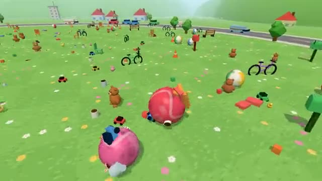

# Sticky Roller

Roll up crumbs, then toys, then cars, then houses. A multiplayer starter game from [Multiplayer Agent](https://multiplayeragent.com): 3D, party, 2–8 players, with bots that fill empty seats.

## How it plays

Roll a sticky ball around a toy town. Anything smaller than you sticks on and you grow, so bigger things become rollable, and smaller players too. Biggest ball when the time runs out wins.

You start 10 cm across on a picnic blanket full of crumbs and candy. Grow past toys, books and chairs, out to the cars on the ring road and the houses at the edge of town. Roll over a ball under three quarters of your size and it bursts: it loses part of its size, its biggest things stick to you, and it starts again somewhere else.

**Controls:** W to roll, A/D to steer, Space to dash, or a stick and a Dash button.

## Make it yours in the Game Builder

Open the [Game Builder](https://multiplayeragent.com), choose **Start from a starter game** and pick Sticky Roller. It opens as version 1 in your studio, ready to play and publish. Then ask for changes, for example:

- Make it a kitchen with fruit, pans and fridges
- Add a golden thing that doubles your size
- Make the round 5 minutes and add skyscrapers

## Run it yourself

1. Get a free publishable key (`pk_…`) at [multiplayeragent.com](https://multiplayeragent.com).
2. In `index.html`, put it in place of `pk_REPLACE_ME` in the `MP_CONNECT` block.
3. Serve the folder (for example `npx serve`) and open it. The 3D engine loads as a module, which browsers block from a file on disk.

Without a key it still runs, offline against bots.

## How it is built

- One `index.html` plus three.js in `libs/`. The comment at the top of the script maps the code and explains the multiplayer.
- Everything in the town is a row in `CONFIG.things` (size, how many, how far from the middle); what each kind looks like is in `LOOKS`, built from boxes, balls and cones. Add a row and a look to add a new kind of thing.
- **Leaderboard:** The biggest balls ever rolled, in cm.
- **Host-run rules:** The host's browser decides who gets each thing (first to touch it) and who rolls up whom; if it leaves, the next player takes over.
- **Host-run rounds:** The host's browser starts each timed round and posts the sizes at the end.
- **Bots:** Bots roll, grow and chase smaller balls until enough people join.
- **Live sync:** Every ball rolls for everyone at once, with the same things stuck on it.
- `?attract` runs it offline with bots only. The preview video is recorded from it.

## License

MIT. three.js in `libs/` is MIT too (Copyright 2010-2024 three.js authors).
